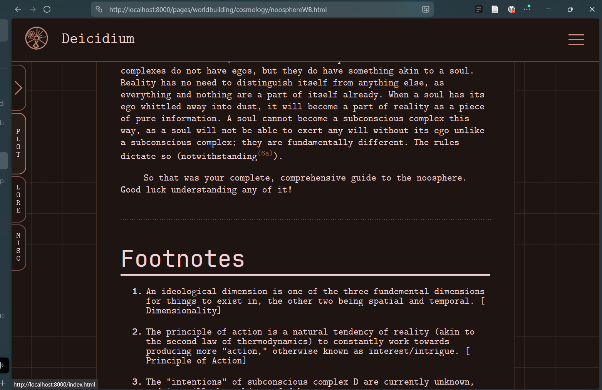

# deicidiumPage
  
HOW TO RUN THE WEBSITE
---
Some reviewers have kindly rejected my ship because they claim that the instructions for running the project are not sufficient. I understand these concerns, so below is a compilation of methods that you can use to run this project properly. README originally written can be found below this section.  
  
Before that, below I will attach an image of the website running if you are skeptical of the website not actually working and for some reason can't go to it to check that it does run (or are just lazy, which I understand), below is an image of the project running in the Zen browser. Similar to the dozens of other screenshots I have of the project running in my devlogs, it depicts the project running. If you believe this photo evidence is doctored, or AI generated in any way, visit the website so you can see that it works, and that the image is valid.  
  

  
If you want all the features of the website, there are two things you can do. Before these steps, ensure that you have a browser installed, as you will not be able to browse the internet to use the website if you do not have an internet browser. Number one is to access the website directly by visiting the link:
  
https://idi0cy.github.io/deicidiumPage/
  
This link will lead directly to the github.io page that I have set up specifically so you can access the entire website in one link. This link will indeed run the website on your browser, provided you possess an internet connection.  
  
What if you need to run it locally for whatever reason? You can start a localhost server with python, so first follow these steps.  
  
Keep in mind that these steps are completely optional, and the link provided will work infinitely better. Also keep in mind that these steps are not required at all for project shipping in accordance with the Terra FAQ as well as the submission guidelines for hackclub.  
    
1. Install python. To use python on your computer to run the python command, you are going to need to have python installed on your computer. Search up python installation on your browser of choice, and you should be directed to the python website where they tell you all about how to install python.
2. Add python to the PATH. Search up a tutorial on how to add python to the Windows PATH (if you're using windows). I can't help you with localhosting the website on MAC or LINUX, so search up a respective tutorial for those operating systems.
3. Download the deicidium page folder, with all the stuff in it. Navigate to the github repository, and hit the big green "code" button. Then, select "download ZIP." Rename the zip file to whatever you want. After extracting, rename the folder inside of the zip file title "deicidiumPage-main" to just "deicidiumPage." You can rename files in the file explorer.
4. Run the below command in your command terminal, from any location (if you've added python from the PATH)
  
`python -m http.server 8000 --directory C:\your\path\here\deicidiumPage\ --bind 127.0.0.1`
  
5. Be absolutely sure that you are using python. The -m might not be necessary depending on your operating system. You should be locally hosting the file that contains the website, that is the "deicidiumPage" folder you named. If you are not locally hosting the file that contains the website, you will not be locally hosting the website, and the website will not run on your locally hosted web server because you have not locally hosted the file containing the website. The last argument --bind is optional, and it makes the web server only accessible from your device, not anyone on the wifi network.  
6. After all of these steps, visit the locally hosted website at the below link:  
  
`http://localhost:8000/`
  
7. You now have access to the website. It should work now.
8. If you don't want the file to be named deicidiumPage, then change the deicidiumPage-main file name to whatever you want, and just use that pathway instead in the command.
  
If you are still confused, and require me to further explain how you can run a website on your web browser by visiting the website, I can help just a little bit more.  
  
I'm assuming you followed the local host example. If you didn't, remember that you have to download the folder deicidiumPage so you have the folder on your machine. If you can't download and extract code from github... that's rough buddy. Just search it up, and make sure to extract the files.  
  
If you have a default browser set, double click the index.html file under the deicidiumPage-main file (or deicidiumPage, if you renamed it that). This will open it in your browser. This version will be severely lacking in features. No absolute links will work, and your website customizations will not function.  
  
If you are reviewing this project and wish to run it some other way, or believe that I have not provided enough information pertaining to the running of this project, the below statement is here to clarify.  
  
Throughout this readme I have achieved all shipment criteria setout by the hackclub authority.
1. Non-ephemeral link that leads to the project demo page
2. Less than two minute setup, provided you used the link provided for github.io and already have any internet browser installed
3. No gated credentials
4. A demonstrative image of the project working
5. All elements of project that purport to function work, with the exception of sidebar navigation links, in which only some articles are filled out and the others give an alert that the page will be coming soon, meeting the burden of a minimum viable project (MVP) as set out in the Terra FAQ.
6. Can be experienced with those with less technical knowledge/knowhow
7. The entire codebase has been published on github
  
MY ACTUAL ORIGINAL README
---
Hello boys, girls, neithers, boths and in between!  
  
Welcome to deicidiumPage, or I guess deicidium website now because I've done more than just the one. Let me give you a quick breakdown of what's going on. In the bright bloody year of 202...4? I started a personal writing project that I originally named the TWD, but then I changed it after realizing Deicidium was such a better name that actually has some relevance, and I was not complaining that I could differentiate from The Walking Dead. It initially started as just a writing project for dumb worldbuilding, but then it also turned into dumb character building and of course dumb plot building.  
  
Deicidium's website is taking over the family business and is assuming full control of my free time now, as I'm doing web development to make a fun little wiki for all my terrible ideas. I am coding this completely from scratch, blank HTML files and everything, and I'm starting to learn some very chopped javascript.  
  
So uhh, what else do you need to know other than the elevator pitch?  
  
Right, How Do You Use This Project?
  
It's a website. Just go to https://idi0cy.github.io/deicidiumPage/ to visit the website on your web browser. If you want to click on the buttons, use your mouse to do that. You can also hover on them. You'll probably have to press and hold on the phone, and while I tried to make everything as space compatible, all the hover transitions might be missed out on, so who really knows. I haven't tested it on the phone yet.  
  
You can automatically change the colour scheme if you want. That's a nice feature I added, and you can find it in the menu tab under "settings". Very cool stuff. Remember that this is an unpolished medium to express shotty worldbuilding so far, so take everything you read lore-wise with a drop of alcohol. If you're of legal drinking age. Don't sue me.